  
  
  

I lead the technical team at **GR Scholastic**, where I'm the sole builder of the internal platform stack. I take
systems from the first conversation with the people who use them to production, then keep them running.

- **Agentic AI in operations:** saved ~6 weeks of manual work and avoided ~4 extra hires, within the existing AI budget.
- **Production ML:** Vertex AI and OpenAI record classification at ~94% accuracy, plus a CRF model for PDF extraction.
- **Team:** hired 4 from 20+ candidates, and set the team's AI-assisted workflow (Cursor, Claude Code).

<picture>
  <source media="(prefers-color-scheme: dark)" srcset="assets/services-dark.svg">
  
</picture>

<picture>
  <source media="(prefers-color-scheme: dark)" srcset="assets/activity-dark.svg">
  
</picture>

<picture>
  <source media="(prefers-color-scheme: dark)" srcset="assets/stack-dark.svg">
  
</picture>

🏎️ Off the clock: I can name most Formula 1 World Champions from memory. · Cards are generated by
[a script](scripts/build-profile.mjs) and refreshed daily; work-account activity is shown as totals only.
