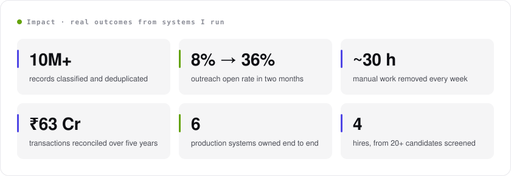
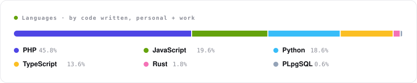

<picture>
  <source media="(prefers-color-scheme: dark)" srcset="assets/hero-dark.svg">
  
</picture>

  
  
  
  

I lead the technical team at **GR Scholastic** and own six production systems end to end: I gather the requirements,
design and build each system, deploy it, and keep it running. My work spans applied AI, data platforms, full-stack and
the infrastructure underneath.

- **Agentic AI in operations.** The workflows I built across the company saved ~6 weeks of manual work and avoided
  ~4 extra hires, all within the existing AI budget.
- **Production ML.** Vertex AI and OpenAI record classification at ~94% accuracy, a CRF model for PDF extraction, and
  a plain-English ops copilot over MCP with dry-run, audit log and undo.
- **Team.** Screened 20+ candidates and hired 4, then set the team's AI-assisted workflow (Cursor, Claude Code).

<picture>
  <source media="(prefers-color-scheme: dark)" srcset="assets/impact-dark.svg">
  
</picture>

### Selected work

**🔬 [Research Intelligence Platform](https://rahulcode97.github.io/Unified-Financial-Intelligence/research-platform.html)** · 2025–26 
Collects, classifies and ranks 10M+ academic profiles across 2,000+ universities so marketing targets by work history
instead of blind lists. It runs on a self-healing Rust fleet built from 10 retired office PCs, with a hybrid
scikit-learn + LLM pipeline behind it. 
Python · FastAPI · PostgreSQL · Rust (Tokio, Axum) · scikit-learn · MCP · React · Coolify ·
[ML pipeline →](https://rahulcode97.github.io/Unified-Financial-Intelligence/ml-analysis.html) ·
[The fleet →](https://rahulcode97.github.io/Unified-Financial-Intelligence/fleet.html)

**₹ [Finance Reconciliation Suite](https://rahulcode97.github.io/Unified-Financial-Intelligence/finance-suite.html)** 
Brings CCAvenue, PayPal and bank transfers into one console that auto-matches 98.4% of transactions, flags GST
mismatches and builds the monthly report in one click. Month-end went from a week to under an hour. 
Pandas · React · Node.js · PHP · MySQL · Google Cloud ·
[Interactive demo →](https://rahulcode97.github.io/Unified-Financial-Intelligence/dashboard.html)

<picture>
  <source media="(prefers-color-scheme: dark)" srcset="assets/stack-dark.svg">
  
</picture>

<picture>
  <source media="(prefers-color-scheme: dark)" srcset="assets/activity-dark.svg">
  
</picture>

<picture>
  <source media="(prefers-color-scheme: dark)" srcset="assets/languages-dark.svg">
  
</picture>

🎯 **Open to** forward-deployed, applied-AI, full-stack and data engineering roles. 
🏎️ **Fun fact:** I can name most Formula 1 World Champions from memory.

Stat cards are drawn by [a small script](scripts/build-profile.mjs) and refreshed daily by GitHub Actions. They
include work-account activity as totals only.
